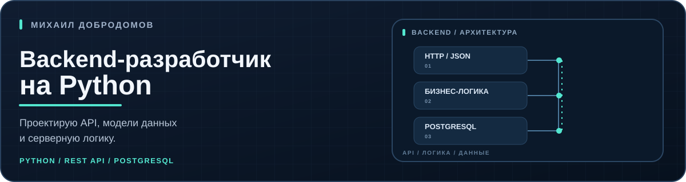
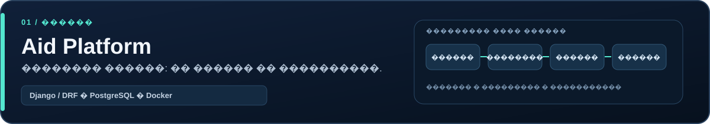
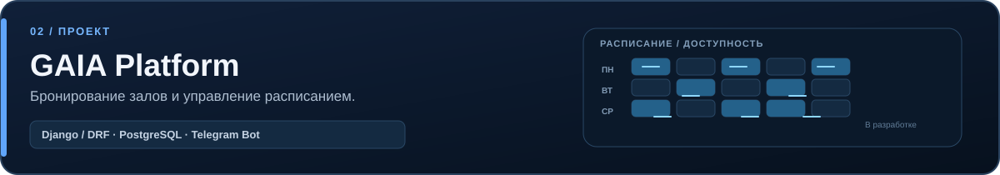
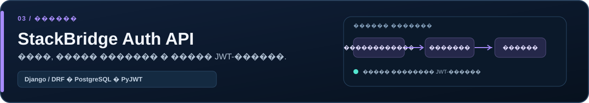

<a href="#избранные-проекты">Проекты</a> &nbsp;·&nbsp; <a href="#технологии">Технологии</a> &nbsp;·&nbsp; <a href="#инженерный-подход">Инженерный подход</a> &nbsp;·&nbsp; <a href="https://github.com/IMikhailI?tab=repositories">Все репозитории</a>

Разрабатываю backend-сервисы на **Python и Django REST Framework**. Работаю с REST API, моделями данных, аутентификацией и разграничением доступа.

## Избранные проекты

[Aid Platform](https://github.com/IMikhailI/aid_platform) — **MVP платформы адресной помощи**. Заявки, модерация, разграничение доступа и отслеживание статусов. Сценарии оказания помощи работают в демонстрационном режиме.

[GAIA Platform](https://github.com/IMikhailI/GAIA_backend-) — **проект в разработке**: бронирование залов, проверка доступности, управление расписанием и Telegram-бот для персонала.

[StackBridge Auth API](https://github.com/IMikhailI/StackBridge_test_task) — **демонстрационный REST API** с регистрацией, ролями и правилами доступа к ресурсам. Включает проверку владельца и серверный отзыв JWT-сессий.

## Технологии

**Backend:** Python · Django · Django REST Framework  
**Данные:** PostgreSQL · SQL  
**Инструменты:** Git · Docker · Docker Compose

## Инженерный подход

- Проектирование API и реляционных моделей данных.
- Аутентификация, роли и проверки доступа к ресурсам.
- Документация, проверочные API-сценарии и контейнерный запуск.
