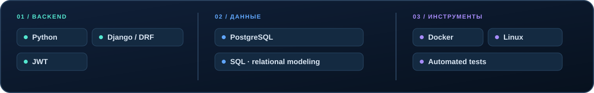

<a href="#projects">Проекты</a> &nbsp;·&nbsp; <a href="#stack">Технологии</a> &nbsp;·&nbsp; <a href="#approach">Инженерный подход</a> &nbsp;·&nbsp; <a href="https://github.com/IMikhailI?tab=repositories">Все репозитории</a>

Разрабатываю backend-сервисы на **Python**: от проектирования REST API и моделей данных до аутентификации, разграничения доступа и интеграций. Особое внимание уделяю архитектуре, PostgreSQL и поддерживаемости кода.

<h2 id="projects">Избранные проекты</h2>

[Aid Platform](https://github.com/IMikhailI/aid_platform) — платформа адресной помощи: создание и проверка заявок, управление жизненным циклом, разграничение прав и защита персональных данных. В опубликованном репозитории backend реализован на **Django REST Framework**; предусмотрены проверочные API-сценарии. Исполнение помощи в MVP демонстрационное, без реальных платежей.

[GAIA Platform](https://github.com/IMikhailI/GAIA_backend-) — backend для управления площадкой: доступность залов, бронирования, меню и административные сценарии с Telegram-ботом. Стек текущего кода — **Django / DRF и PostgreSQL**. Проект в разработке; настройки зависимостей и авторизацию административных API ещё нужно завершить.

[StackBridge Auth API](https://github.com/IMikhailI/StackBridge_test_task) — REST API с аутентификацией и гибкой авторизацией: роли пользователей, разрешения на уровне ресурсов, проверка владельца и отзыв JWT-сессий на сервере.

<h2 id="stack">Технологии</h2>

Показан стек, подтверждённый текущим кодом репозиториев; технологии не приписываются проектам без проверки.

<h2 id="approach">Инженерный подход</h2>

- **API и безопасность** — понятные контракты, аутентификация, роли и проверки прав доступа.
- **Данные и надёжность** — реляционные модели, SQL, миграции и корректные переходы состояний.
- **Качество реализации** — тестируемый код, документация и воспроизводимый запуск в Docker.

<strong>Интересуюсь проектированием надёжных backend-систем и развитием их архитектуры.</strong>

<a href="https://github.com/IMikhailI?tab=repositories">Все репозитории</a> &nbsp;·&nbsp; <a href="https://github.com/IMikhailI">Профиль GitHub</a>

